# Branded installer walkthroughs

This page has automated screenshot walkthroughs for each brand build
(`docs/branding-and-distribution.md`). A test makes these images; nobody
selects them by hand. `tests/gui/branded-walkthrough.spec.js` assembles each
brand's real embedded assets from `app/branding/<brand>/`. These are the same
brand.json, logo, typeface and theme that a `-X main.brandID=<brand>` binary
compiles in.

The test drives the real frontend bundle through the four
journey screens. On each screen, it asserts that the build shows its own
name, mark and look. A branded build must never show the word "wootc".
When you run the Playwright suite again, it refreshes each image below.

**Live video walkthroughs:** each distribution that passed a full
GUI-driven E2E has its own timelapse in the gallery at
**https://tuna-os.github.io/wootc/e2e/** . In each timelapse, a real Windows
VM installs that image through the real GUI. It then moves the user data and
goes back to Windows. The most recent green run of each image is always at
[/e2e/latest/](https://tuna-os.github.io/wootc/e2e/latest/). Cuts publish
automatically on green (`e2e-gui.yml`), one directory per distribution.

Each brand has the same journey:

1. **launchpad**: the brand's catalog, with its default image selected.
2. **progress**: the reassurance screen in the brand's look.
3. **done**: the success screen with the brand's own mark.
4. **manage**: the branded way back in ("Restart into …") and the way out.

## Bazzite — "The next generation of Linux gaming"

| | |
|---|---|
| 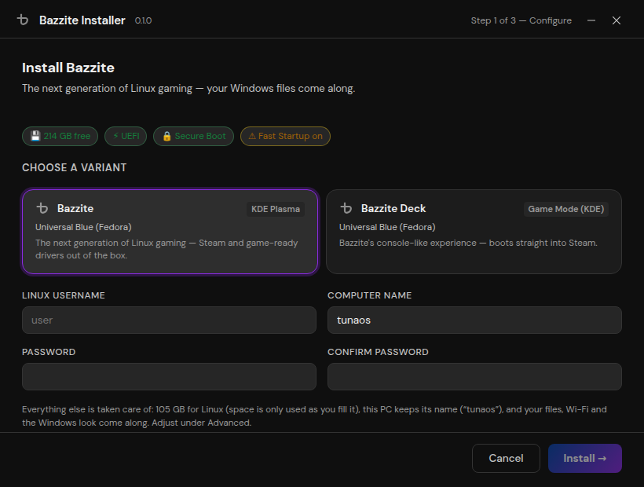 | 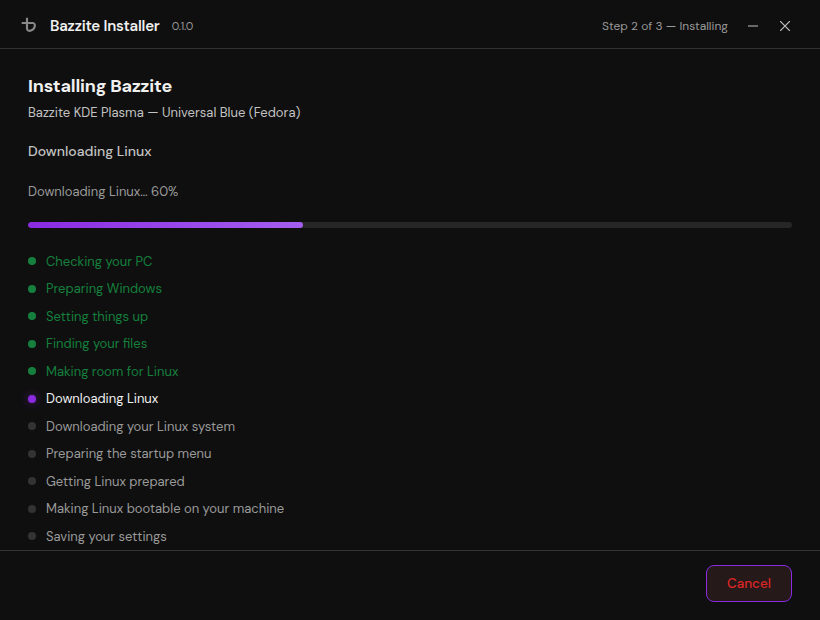 |
| 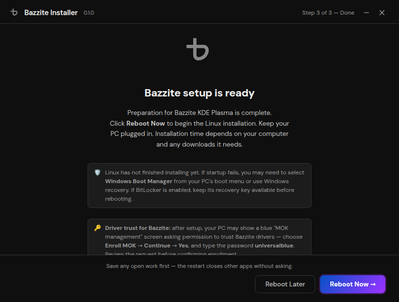 |  |

### Bazzite brand test record

This record is for the `-X main.brandID=bazzite` build (`Bazzite-Installer.exe`).
Each row has one check, the result, and the evidence.
A unit test or a mock GUI test is not proof that the product works on a computer.
Only the hosted E2E rows show that.

| Check | Status | Evidence |
|---|:--:|---|
| Name, product, exe and publisher never say "wootc" | ✅ | `TestBazziteBuild_WearsItsOwnIdentity` (`app/bazzite_brand_test.go`) |
| Catalog is `bazzite`, then `bazzite-deck`, with `bazzite` selected | ✅ | `TestBazziteBuild_OffersOnlyBazziteImages`; launchpad screenshot above |
| Image refs are `ghcr.io/ublue-os/bazzite:stable` and `bazzite-deck:stable` | ✅ | `TestBazziteBuild_OffersOnlyBazziteImages` |
| Both images use GRUB2 without composefs and queue the `universalblue` MOK enrollment | ✅ | `TestBazziteBuild_OffersOnlyBazziteImages`; `tests/unit/mok-enrollment.bats` |
| The default channel (alpha) still offers the default image | ✅ | `TestBazziteBuild_DefaultChannelStillOffersTheDefaultImage` |
| No custom image field, on every channel | ✅ | `TestHideCustomImage_TightensPolicy`; walkthrough launchpad test |
| The image downloads on Windows, so the deployer needs no network | ✅ unit, ⚪ E2E | `TestBazziteBuild_PreloadsTheImageOnWindows`. The E2E sets `WOOTC_PRELOAD=0`, so no run proves this path ([#217](https://github.com/tuna-os/wootc/issues/217)) |
| Logo, typeface and theme are in the exe; nothing comes from the network | ✅ | `TestBazziteBuild_AssetsNeverFetchAtRuntime` |
| Light-mode and dark-mode Windows both get the Bazzite look | ✅ | `TestBazziteBuild_ThemeIsNotConditionalOnColorScheme`; walkthrough test "a light-mode Windows still gets the brand look" (`05-light-mode.png`) |
| Add/Remove entry and the restart notice say "Bazzite" | ✅ | `TestBazziteBuild_WindowsSurfacesNeverSayWootc` |
| Recovery messages never say "wootc" | ✅ | `TestBazziteBuild_RecoveryMessagesNeverSayWootc` |
| Deployer GRUB menu says "Install Bazzite (automatic)" / "(debug)"; the systemd-boot title says "Bazzite installer" | ✅ unit, ✅ E2E boot | `TestDeployerMenus_BazziteBuildSaysBazzite`; `TestDeployerMenus_LookupsDoNotDependOnTheTitle` pins that the marker, `set default=0` and the boot paths are unchanged, so older and newer installs are found the same way. [Run 38803985996](https://github.com/tuna-os/wootc/actions/runs/38803985996) (2026-10-15) booted the branded deployer menu and passed every check. The E2E log does not record the menu text |
| Windows-side errors (BitLocker busy, legacy BIOS, VM viewer, ESP guards, boot repair, uninstall check, unsafe-state dialog) never say "wootc" | ✅ | `TestUserFacingStringsNeverHardcodeWootc` (source scan: every string literal in `app/` that says "wootc" is an identifier or marker on an explicit list) |
| Launchpad, progress, done, manage, uninstall dialogs, interrupted, recovery and failed-run screens never say "wootc" | ✅ | `tests/gui/branded-walkthrough.spec.js`. Windows paths such as `C:\wootc\disks` are the on-disk contract, so the test ignores them |
| The done screen shows the MokManager step and its password | ✅ | walkthrough test "done celebrates the brand" |
| Exe version resource: product "Bazzite Installer", file `Bazzite-Installer.exe`, company "TunaOS", no copyright | ✅ | local `packaging/build-windows.py --brand bazzite --version v0.4.0` build, read with `pefile` (2026-10-15). The company is the distributor, not Universal Blue, while `blessing.json` is pending: `TestUnblessedBrandsNeverClaimTheOwnerAsPublisher`, `tests/unit/test_windows_resources.py` |
| Add/Remove publisher and winget draft publisher are "TunaOS" while unblessed | ✅ | `TestBazziteBuild_PublisherIsTheDistributorWhileUnblessed`; `tests/unit/test_winget_brand.py`; `tests/unit/brand-blessings.bats` |
| The release builds the exe, and the log names it as unblessed | ✅ | `tests/unit/brand-blessings.bats`; `packaging/brands.sh explain` |
| winget manifests render into `Bazzite.Installer` and are not submitted | ✅ | `tests/unit/brand-blessings.bats`; `packaging/winget/render-brand.sh bazzite` |
| Hosted GUI E2E, `bazzite:stable`: install, MOK under Secure Boot, Phase 2, user data, Windows return | ✅ 2026-08-24 | [run 32679831098](https://github.com/tuna-os/wootc/actions/runs/32679831098) on `4fd4bc8` |
| Hosted GUI E2E, `bazzite:stable`, launch fix and MOK fix | ✅ 2026-10-15 | [run 38792319332](https://github.com/tuna-os/wootc/actions/runs/38792319332) on `b102db9` (PR #609, which contains PR #516). Install, MokManager under Secure Boot, Phase 2, the Documents file in Linux, and the return to Windows passed. The earlier run [38731850924](https://github.com/tuna-os/wootc/actions/runs/38731850924) on `13afd74` stopped at the launch deadlock that PR #516 fixes |
| Hosted GUI E2E, `bazzite-deck:stable`, current `main` | ✅ | [run 38844455285](https://github.com/tuna-os/wootc/actions/runs/38844455285) on `139c29a` (2026-10-16, PR #633). The GUI install, the deploy, MokManager under Secure Boot, Phase 2, the user-data check and the return to Windows passed. Before that, [run 38832644743](https://github.com/tuna-os/wootc/actions/runs/38832644743) on `97552e0` (2026-10-16, PR #629). The GUI install, the deploy, MokManager under Secure Boot, Phase 2 and the return to Windows passed. The user-data check could not run because the Phase-2 guest agent never answered. The deployer warning that `qemu-ga` was absent after injection was a probe defect: the image ships `/usr/bin/qemu-ga`, and the `bazzite:stable` run that passed logged the same warning. [#633](https://github.com/tuna-os/wootc/pull/633) fixes the probe. Earlier, [run 38804321935](https://github.com/tuna-os/wootc/actions/runs/38804321935) ran out of deployer scratch space, and [run 38731854579](https://github.com/tuna-os/wootc/actions/runs/38731854579) stopped at the launch deadlock |
| Hosted GUI E2E, `bazzite:stable`, branch of PR #516 (launch fix) | 🔴 inconclusive | [run 38735109866](https://github.com/tuna-os/wootc/actions/runs/38735109866) on `2eb7791` (2026-10-15). The Bazzite installer started, selected `ghcr.io/ublue-os/bazzite:stable` (no image mismatch), and the harness clicked Install. Then "Making room for Linux" stopped with "root.disk already exists". The bluefin run of that branch stopped with the same error, so the cause is not specific to Bazzite |
| Phase 3 (graduate to a native disk) with Bazzite | ⚪ | not run |

Gaps that this page does not close:

- The firmware boot entry and the data volume label (`wootc-data`) still say "wootc". A Bazzite user can see them in the firmware one-time boot menu and in File Explorer.
  They stay because the code that finds them matches **by that name**, not by a stable identifier:
  - The firmware entry's description *is* its identity. `wootcEntryIDs` and `bootChainProblems` (`boot_txn.go`), `planBootRepair` (`boot_repair.go`), `hasWootcBCDEntry` (`installer_windows.go`), the uninstall sweep, `setup-wootc.ps1`, and `run-e2e.sh` all match `description wootc`. If a branded description such as "Bazzite" were matched there, cleanup could claim a user's real Bazzite entry. It needs a GUID-first lookup that also accepts the legacy name, and an E2E run.
  - `wootc-data` is part of the partition-removal gate (`partition-policy.ps1` `Get-WootcPartitionRemovalBinding`, together with the receipt GUIDs). Orphan detection in `installer_windows.go` and the Phase-1 E2E assertion also find the volume by that label. Weakening a gate that guards `Remove-Partition` needs its own change and an E2E run.
- `matrix.tsv` has no Bazzite cell. The script path (`setup-wootc.ps1`) queues the MOK enrollment only since the `MokEnroll` axis: `run-e2e.sh` reads the catalog's `mokEnroll` for the target image and passes `-MokEnroll`, which adds the same `wootc.mok=enroll` the app sets. No script-path cell has proved it yet, so the GUI runs above remain the Bazzite evidence.

## Bluefin — "The next generation Linux workstation"

| | |
|---|---|
| 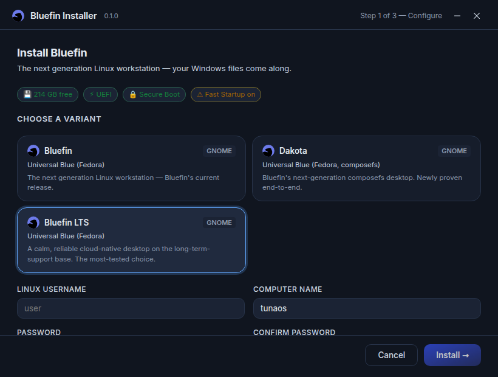 | 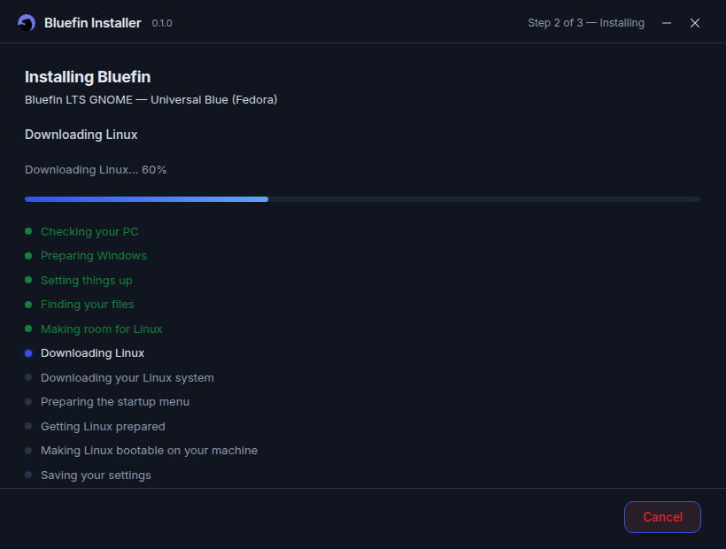 |
| 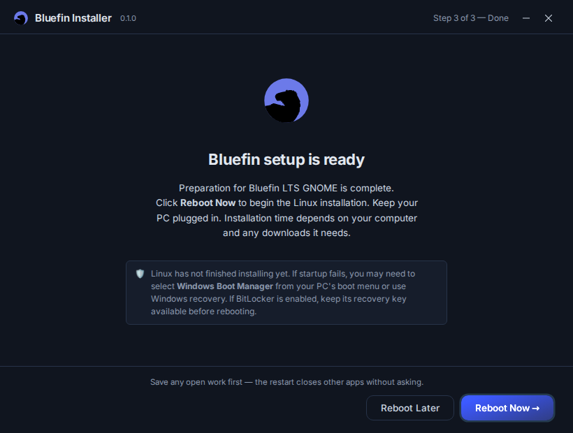 |  |

## Aurora — "Simply delightful"

| | |
|---|---|
| 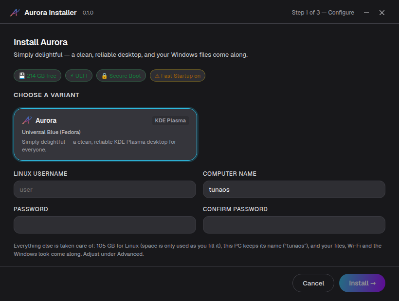 | 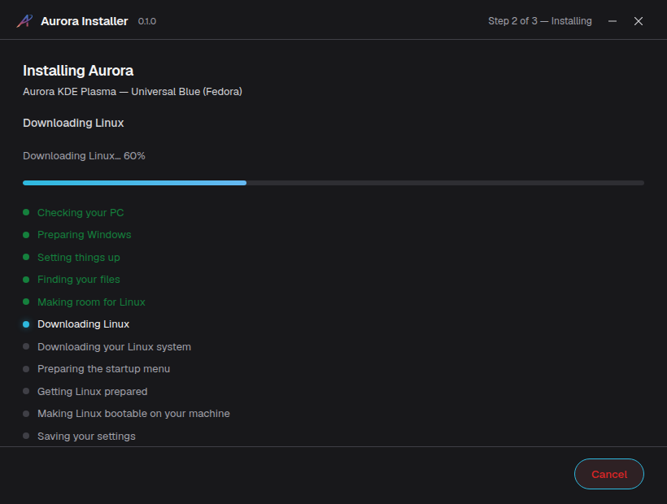 |
| 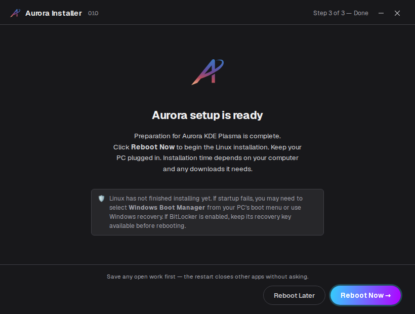 |  |

## TunaOS

| | |
|---|---|
| 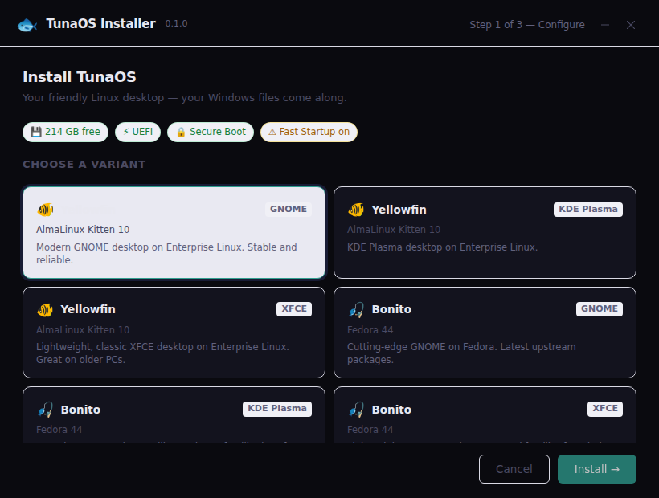 | 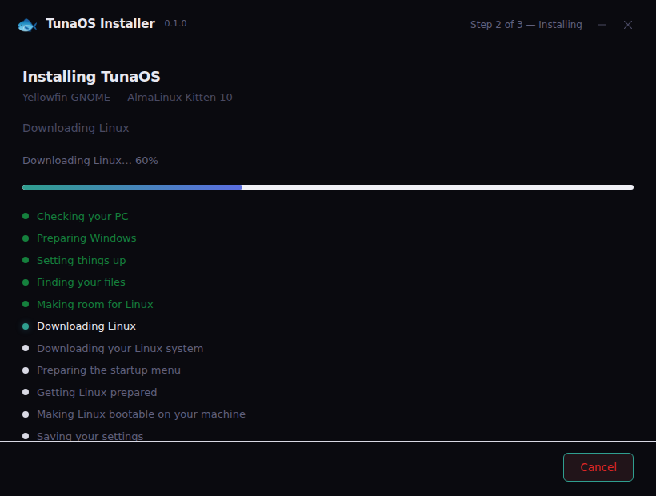 |
| 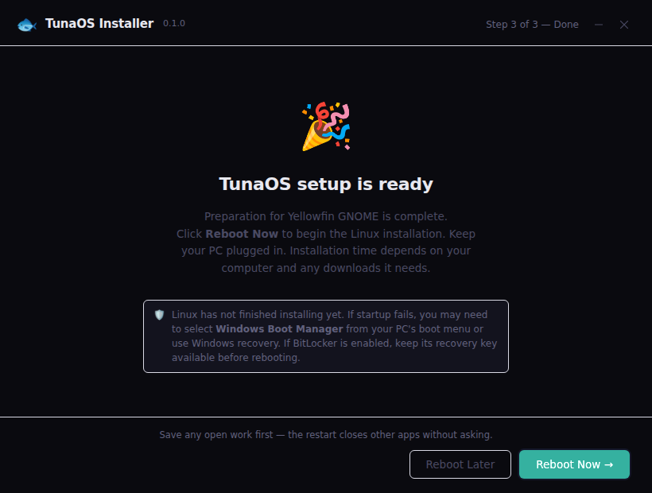 |  |

## wootc (generic)

The un-branded engine, as shipped today — also covered by the main
[GUI walkthrough](gui-walkthrough.md).

| | |
|---|---|
| 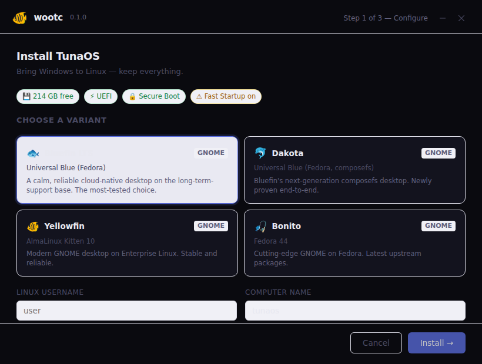 |  |
| 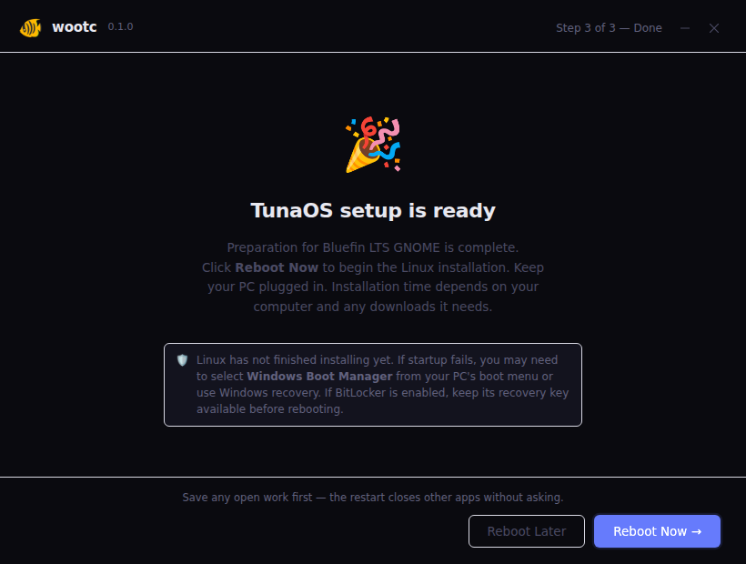 |  |
