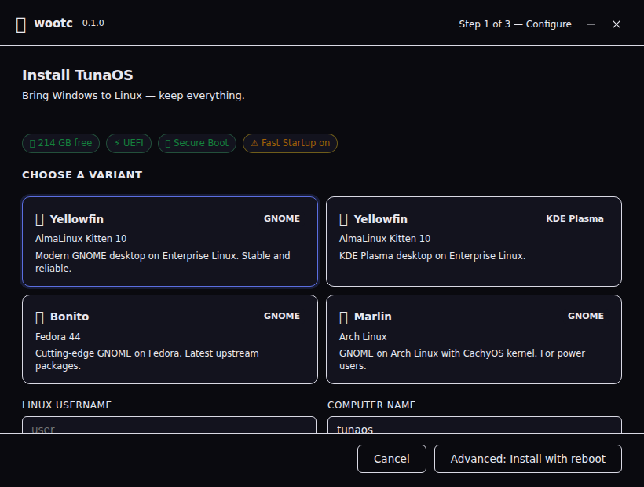
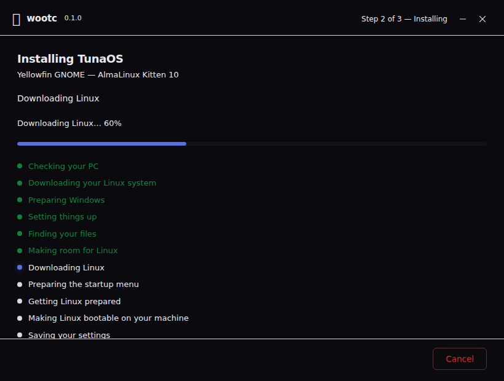

# wootc User Guide

wootc can install Linux in a disk file beside Windows.
The current installer prepares a native Linux boot after a restart.
The intended Phase 1 will run Linux inside Windows first.
That complete VM journey remains under development.

Windows remains the default boot choice during the native install path.
The installer changes boot entries, boot files, and Windows power settings.
Some storage choices also change partitions. Read the proposed plan before you continue.

This guide describes **current source**, not a guarantee that the latest
published tag contains every feature. On 2026-11-02 the observed latest
non-prerelease remained `v0.1.0-alpha.1`; main has newer native setup packages.
Follow the [download guide](getting-started.md) for actual download names and
[current status](status.md) for evidence and limits.

## Contents

1. [Is my PC ready?](#1-is-my-pc-ready)
2. [Install Linux](#2-install-linux)
3. [First boot into Linux](#3-first-boot-into-linux)
4. [Bring your stuff over](#4-bring-your-stuff-over)
5. [Try it first, commit later](#5-try-it-first-commit-later)
6. [Import from another disk or a backup](#6-import-from-another-disk-or-a-backup)
7. [Encryption & BitLocker](#7-encryption--bitlocker)
8. [Go Linux-only](#8-go-linux-only)
9. [Uninstall](#9-uninstall)
10. [Problems and recovery](#10-problems-and-recovery)

## 1. Is my PC ready?

The app checks your PC at startup. Its current requirements include:

- **Windows 10 or 11**, 64-bit, with UEFI firmware.
- **Enough free space on an admitted storage volume.** The native plan needs a
  Linux disk of at least 20 GB. It also needs image-dependent scratch space,
  space for any offline image copy, and a safety reserve. The app reads the
  reserve for the selected image and lowers the offered disk size to fit.
  A blanket "35 GB is enough" is not valid for every current image or frontend.

  VM preparation has a separate conservative gate: 88 GiB of free space on the
  host. See [managed VM](managed-vm.md).
- **Secure Boot can remain on.** The installer checks whether your firmware trusts its Microsoft-signed loader before it changes boot configuration.
  It stops if it cannot confirm that trust.
- **BitLocker off for the alpha install path.** The released alpha refuses an encrypted Windows drive.
  You can wait for support; the installer does not decrypt Windows for you.
  See [§7](#7-encryption--bitlocker) for the experimental design.

You do not need a bootable USB for this path.

### Hardware warnings are not compatibility certificates

Current source will check aliases for Linux PCI modules in a staged image before
disk or boot changes. A proven lack of an important PCI driver can stop the plan.
This refusal needs complete inventories from Windows and from one target kernel.
Nouveau-only graphics or firmware-framebuffer support gives a warning, not a
promise of an accelerated desktop.

Missing declared firmware also warns: Windows cannot establish which Linux
firmware variant the device uses. USB PnP identifiers do not supply a complete
Linux modalias. Partial or unknown inventory gives a warning, not a fabricated
match. Without a local/preloaded image the assessment may be unknown.
Neither unknown nor warning means green.

The installer keeps the detailed report under the install root's
`bundle\hardware-report.json`; include it with a compatibility report.

## 2. Install Linux

Use an artifact present in the chosen release. The older published executable
for the generic build is `wootc.exe`. Current source uses native setup packages:
`wootc-Installer-Setup.exe` (or a distribution-specific setup). These install
the WinUI shell and protected engine. A native release may retain
`wootc-legacy.exe` for one release.

The older Wails interface needs WebView2; the native shell does not.
These artifact generations are not interchangeable.

*Historical Wails/mock illustration, not a screenshot of the RC/native package.
This guide asserts no RC SHA for the retained image.*

1. **Pick a desktop.** The catalog has GNOME, KDE Plasma, Niri, and XFCE entries across several Linux bases.
   The selected brand and release channel determine the offered subset and
   default; a branded build need not default to Bluefin. See the
   [release policy](RELEASING.md#alpha-now).
2. **Set a password.** The app proposes your username, computer name, disk size, and encryption choice.
   Review them under **Advanced**. You can also change the Windows look option there.
3. **Review “Make it feel like Windows.”** Defaults differ between frontends;
   do not assume the frontend selects this box. On supported Wayland desktops, the
   helpers transfer your selected wallpaper, accent, keyboard layout, and shortcuts.
   Saved Wi-Fi networks use a separate path.
4. Click **Install**. The app creates the Linux disk file and stages boot files.
   It also configures a one-time boot into the deployer and disables Fast Startup and hibernation.

*Historical Wails/mock progress illustration; current native controls and RC
screenshots need their own retained evidence.*

Restart when you are ready. The one-time boot starts the deployer.
Windows remains the default after that entry expires.
A failed install can need recovery or cleanup. A one-time entry does not guarantee every failure returns safely.

## 3. First boot into Linux

The deployer installs the chosen image into the disk file.
Windows normally returns after that one-time boot.
Open the app again. When the Manage screen offers **Restart into &lt;distro&gt; →**, choose it to schedule a Linux boot.

Linux then boots directly from the disk file on the Windows drive.
Its bootc image provides the installed system and update mechanism.
The boot files on the Windows ESP also need their own update checks.

The boot menu includes Windows. Native installation does not remove Windows.
On the KVM E2E rig, tests passed for some native cycles. See [current status](status.md) for their limits.

## 4. Bring your stuff over

Open **Bring Over From Windows** to review migration categories.
Some preferences can transfer automatically. Other imports need your choice.
Review each category's source, destination, and limits before you import it.

The helpers cover these categories:

- **Files:** Documents, Desktop, Pictures, Downloads, Music, and Videos.
  A folder can initially share its Windows contents. Conversion makes a separate Linux copy.
- **Browsers:** Firefox imports a complete profile, which can include saved passwords.
  Chrome and Edge can import bookmarks and history. Their encrypted Windows
  stores and login tokens have separate consent, keyring and service-specific
  limits; see [session migration](session-migration.md). A copied or rewritten
  database is not proof that the browser opens signed in.
- **Steam:** a library bridge can use games in place, without another download.
- **Office:** the helper copies your selected styles, dictionaries, and preferences for LibreOffice.
- **Apps:** the dashboard lists apps from Windows and suggests alternatives for Linux.
- **WSL:** selected dotfiles and package lists can help rebuild tools, not clone
  an entire WSL system or transfer its accounts. Follow the
  [WSL migration guide](wsl-migration.md) and keep a separate export/backup.
- **Wi-Fi:** the helper creates NetworkManager connections from saved networks.
  Enterprise networks can need a fresh sign-in.
- **Windows look:** the helpers transfer your selected preferences and shortcuts on supported desktops.

A category's presence does not prove every account or application will transfer.
Check your files and application state on Linux before you remove any source data.
Keep your own backup. Do not assume a repeat import will preserve your later edits.

### Existing Linux files and repeat imports

Import is not permission to replace work already made on Linux. For standard
copies of external files, the helper will publish complete new files.
It will not overwrite an existing destination and will refuse unsafe
symlinks/special files. For Office templates, fonts, autocorrect and defaults,
the helper will preserve native content that differs. It will not count that
content as migrated.

Dictionary append uses a recovery journal. It refuses if the state of an
unfinished append changes. Read each category's result. A selected category that fails,
partly completes or lacks verification makes external import return nonzero,
even if others completed. The GUI must show the item's error and the action
needed, not “All set.”

A plan for desktop-look changes counts as partial until the helper applies it,
not as a completed preference import.

Browser import uses safe source traversal and exclusive publication.
If the directory for Firefox import exists, the helper refuses a repeat copy to
preserve Linux edits. The helper does not rewrite existing Firefox `profiles.ini`.
A copied profile may need manual registration. That case reports failure/advice,
not a false complete result.

Failed copies can retain private `.wootc-*.partial` directories for inspection.
Do not delete source data or assume a retry will overwrite/repair the target
automatically.

The Steam bridge keeps an existing library VDF byte-for-byte. If Steam has not
registered the Windows library, use Steam's **Add Library** UI. The bridge does not
silently rewrite the configuration of native libraries. WSL dotfiles, `.ssh`
and Brewfile imports will also preserve bytes that differ from those at the source.
Manually merge the configuration/formulae you want; do not assume a retry
replaces them.

Per-item `copied`, `alreadyPresent`, `preserved` and `failed` outcomes describe
what happened. None proves a live account has signed in.

VS Code, Telegram, Signal, Thunderbird and OBS file/profile imports also
preserve existing destinations. They publish new files or complete new profiles
exclusively as the target user. The helper does not recursively take ownership
of unrelated native content. The helper creates metadata for Thunderbird only
inside its new bundle.

Read per-app copied, preserved and failed outcomes in `bridge-apps.json`;
failed imports return nonzero. A copy of a messenger profile or a synthetic
fixture is not a verified login. It does not replace the app's own re-link
procedure.

## 5. Try it first, commit later

The RC needs Linux-inside-Windows first, as
[#596's Option A decision](https://github.com/tuna-os/wootc/issues/596#issuecomment-6514382140)
states. Current source can prepare a persistent VM disk with a selected Linux
account, then stop/start that disk through the managed QEMU/WHPX runtime.
It does not yet establish the complete desktop journey for consumers:
`desktopReady` remains false without independent guest evidence.

Use only a matching signed runtime and an explicitly admitted image.
See [managed VM requirements and lifecycle](managed-vm.md) before you try it.
A helper receipt or QEMU process is not proof of graphical login, persistence,
or native promotion. Current promotion of a managed disk can try to export
verified boot inputs through read-only access. It still reports **not armed**.

It does not silently redeploy, discard the existing system or write BCD/ESP.
[ADR 0004](adr/0004-restore-vm-first-product.md) needs the same installed
system and data to survive eventual native boot; that positive gate remains open.

## 6. Import from another disk or a backup

On Linux, **Bring Your Windows Over** can import from another Windows drive.
The source can be a second internal disk, a USB drive, or a backup.

1. **Scan** for Windows drives.
2. **Unlock** an encrypted source with your password or 48-digit recovery key.
   This import path mounts the source read-only. It does not decrypt the drive in place.
3. **Pick the user** whose files you want.
4. **Choose the categories** to import and review their destinations.

This separate import path does not open the alpha's encrypted-PC install gate.

## 7. Encryption & BitLocker

**Not yet available in the alpha:** installation on an encrypted Windows drive.

The alpha refuses to install on a BitLocker-protected Windows drive. **Editable Documents: not proven green yet.**
Experimental code and VM results do not change that release policy.
The editable Documents candidate still needs its own complete acceptance run.
See [current status](status.md) and [issue #34](https://github.com/tuna-os/wootc/issues/34).

The experimental storage plan can put Linux on an unencrypted volume while Windows retains BitLocker.
It can use another volume or propose a new partition.
A partition change needs a separate safety review; it does not have the same scope as a disk-file install.

**Your BitLocker recovery key.** Linux uses your recovery key to open the Windows drive on each start.
It needs the key to show your Windows folders until you convert them to Linux folders.
The installer writes a copy to the installer folder, which only administrators can read.
The Linux installer moves that copy into the Linux disk and erases the copy on the Windows side.

The TPM path tries to seal the copy to this PC. On a TPM machine, it refuses
a downgrade to default PCRs. It keeps root-only plaintext for a retry and does
not claim that the weaker seal met the requirement.

Only without a usable TPM can the host-only fallback keep a local key for the
seal beside the encrypted recovery key. That fallback does **not** protect
against an attacker who can read the entire Linux disk without encryption.
The helpers try to erase the retained key after conversion of the last linked
Windows folder or deletion of the Linux disk. Deletion does not prove that no
storage remnants or backups remain.

If the sealed copy fails, for example after a TPM clear, Linux writes a message to the system log.
Your Windows folders stay on the Windows drive.
To show them again, save your recovery key as `/etc/wootc/bitlocker-key`, readable only by root, and restart.

Linux disk encryption is a separate choice:

- **TPM auto-unlock:** a planned LUKS/TPM path; current install admission refuses
  `tpm2-luks` until it meets all safety gates. A UI default or option does not
  prove that encryption works.
- **Passphrase:** Linux disk encryption that needs a password at boot;
  verify qualification of the selected image/path.
- **None:** anyone with access to the disk can read its contents.

**One-time MOK enrollment.** Some distributions sign their kernel or drivers with their own key.
Universal Blue images such as Bazzite, Bluefin and Aurora do, so Secure Boot rejects those drivers until you enroll the key.
The installer's final screen tells you if the chosen image needs enrollment.
On the blue **MOK management** screen, approve the key: **Enroll MOK** → **Continue** → **Yes**.
Use the distribution's documented enrollment password, `universalblue`, for supported images from Universal Blue.
Secure Boot stays on, but a later key change can need another enrollment.

## 8. Go Linux-only

Native graduation and Windows removal are different operations.
The current execution path can graduate Linux onto a separate disk that the harness verifies as blank in the test harness.
It retains Windows and the original `root.disk`.
This proof does not establish an install onto free space on the same disk.

The helper also prints plans for an in-place move and Windows removal.
The app cannot execute those plans for normal use.
Do not treat a plan, a converted-folder marker, or a snapshot check as proof that all your data has moved.
The required safety and recovery gates remain open on the [roadmap](../ROADMAP.md).

Keep both systems until you have verified your work and a separate backup.

## 9. Uninstall

Open **Settings → Apps → Installed apps** and find the matching product.
The older generic build registers **TunaOS (wootc)**; branded/native setup
names follow their package identity. Check their appearance in the real Settings UI.
Open that app and choose **Uninstall** on Manage for the engine's data choices.

The uninstaller tries to:

- Remove wootc's boot entries and owned files from the boot partition.
- Remove installer files.
- Restore the recorded Fast Startup and hibernation settings.

It keeps `root.disk` by default. Default cleanup removes known installer
subtrees and only empty disk/root directories. Unfamiliar saved data and VM
metadata remain even when a known root-disk filename is absent.

Select **Also delete my Linux data** only to delete the product tree recursively,
including retained product data. This is more than app removal.
A dedicated volume needs additional ownership and content checks before the app offers to return its space to Windows.
If ownership or contents remain uncertain, the app preserves the partition and gives a reason.

Current-source cleanup must confirm BCD rollback before it removes recovery
tasks, EFI files or state. Boot cleanup, file removal, secret sanitization or
restoration of power settings can fail. Cleanup then reports the error and
retains recovery/retry authority where possible. A request for deletion does
not mean complete cleanup.

A corrupt/unreadable journal or orphaned armed/deployer marker means
**needs repair**, not “no installation.” Removal keeps the Linux disk unless
you explicitly choose otherwise.

The Add/Remove registry entry must carry the engine's ownership marker before
reuse or removal. The engine refuses an unmarked or foreign same-name entry;
it does not adopt that entry automatically. Do not delete its marker or state
to bypass refusal.

An incomplete cleanup can leave files or boot state behind.
Read any reported errors before you retry.
Uninstall does not undo work that you made on a graduated native disk.

## 10. Problems and recovery

- **“Boot Windows once and shut down fully.”** Fast Startup or hibernation can leave the drive locked.
  Boot Windows and use a full shutdown before you retry.
- **Stuck at the boot menu:** choose **Windows Boot Manager**.
  If Windows does not start, use the recovery instructions for that failure.
- **Setup stopped and Windows started again:** open wootc.
  The recovery screen shows the boot configuration that wootc reads now.
  **Keep Windows only** removes the wootc entries from the boot order. It keeps the files, so you can try again later.
  **Repair boot** writes the installer boot files again and sets the next restart to the installer.
  wootc disables a button when it cannot prove that it owns the boot entries or files.
  From a command prompt, `wootc.exe recover --inspect` shows the same report and changes nothing.
  Each check saves its evidence in `C:\wootc\install\repair\`. Attach that folder to a bug report.
- **An import asks you to sign in:** authenticate again in the destination app.
  Browser profile transfer and account credentials have different limits.
- **No TPM:** review the passphrase and unencrypted choices under **Advanced**.
  An encryption choice does not remove the UEFI requirement.
- **Setup stopped before it finished:** open wootc again.
  It shows how the last install ended (cancelled, closed, or failed) and the last step that finished.
  **Continue setup** keeps the checked part of the download and asks for your password again.

  If setup stopped during startup-file changes, it offers repair/removal guidance.
  It also offers that guidance for a damaged or ambiguous journal/marker.
  It does not assume there is no installation.
  Removal will retain Linux data by default.
  Inspect reported errors before you try another install.
  To see the same result in a terminal, run `wootc.exe recover --classify`.
- **Windows asks to scan a drive:** a power cut or forced shutdown can leave it unclean.
  Complete the Windows check and inspect its result. Do not assume every file survived a failed shutdown.

For support, retain the exact release/build SHA, frontend, selected image,
`C:\wootc\state.json` (or the selected drive's install root) and relevant
`logs\` / `install\` evidence. Review it before you share it: logs and profile paths
can contain personal data. Never attach passwords, recovery keys, cookies,
session envelopes or a complete browser profile to a public issue.

Current-source engine diagnostics include JSON lines on **stderr** with
`timestamp`, `attemptId`, stable `phase`, `event`, `duration_ms` and optional
`error_code`. Events are `phase_start`, `phase_complete`, `phase_error` and
`phase_cancelled`; error codes are coarse `operation_failed` / `cancelled`,
not raw failure text. The protected journal will retain errors for diagnosis.
Do not mix stderr diagnostics into stdout for stdio JSON-RPC.

For a Windows profile mapping, review the complete account plan and edit it
before you continue. Secondary generated names use `user1`, `user2`, and so on.
A collision with your selected primary name is not permission to drop a profile.
The engine refuses duplicate, invalid or reserved Linux names.
The reviewed set of Windows profiles must still match what the engine discovers.

The legacy installer refuses if it cannot establish the original interactive user.
It also refuses if alternate-admin elevation changes that identity.
Environment hints are not authority to collect another user's secrets.

If a copy of Documents from encrypted Windows fails, the bridge preserves an
existing Documents directory on Linux. It does not hide native files behind a
read-only Windows bind. Inspect the logged source path and use it for manual
recovery; a fallback is not proof that the copy succeeded. Keep the Windows source.

wootc remains early software. The tests cover some scenarios for native installation in VMs.
It does not establish complete VM-first use or real-hardware acceptance.
See the [status](status.md), [verification ladder](milestones.md), and [roadmap](../ROADMAP.md).
